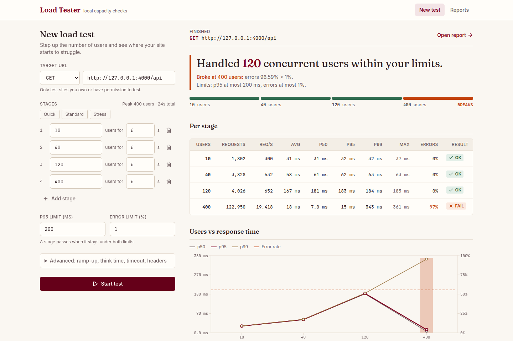
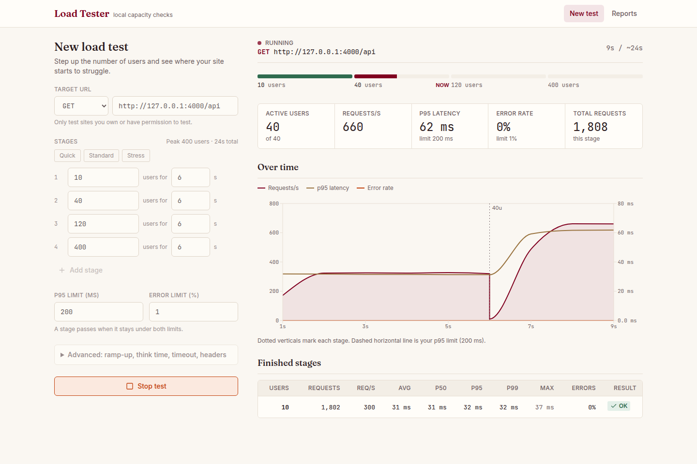
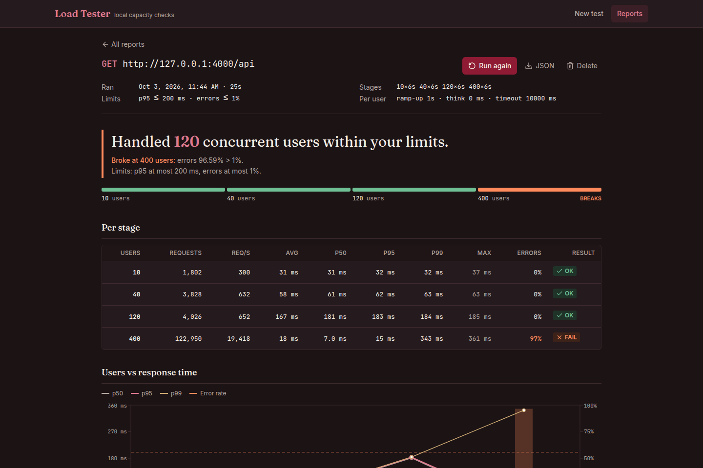
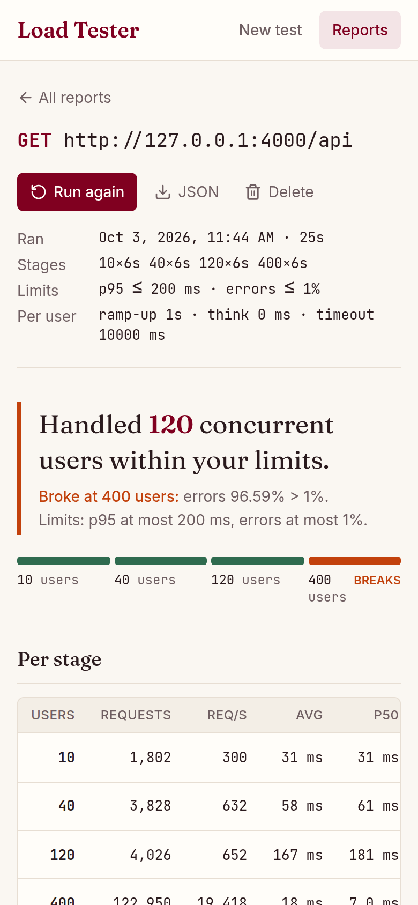
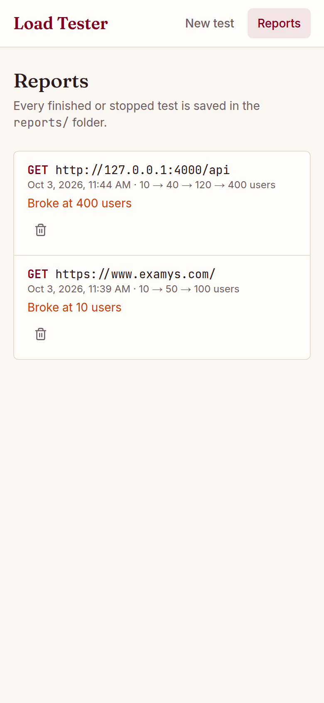
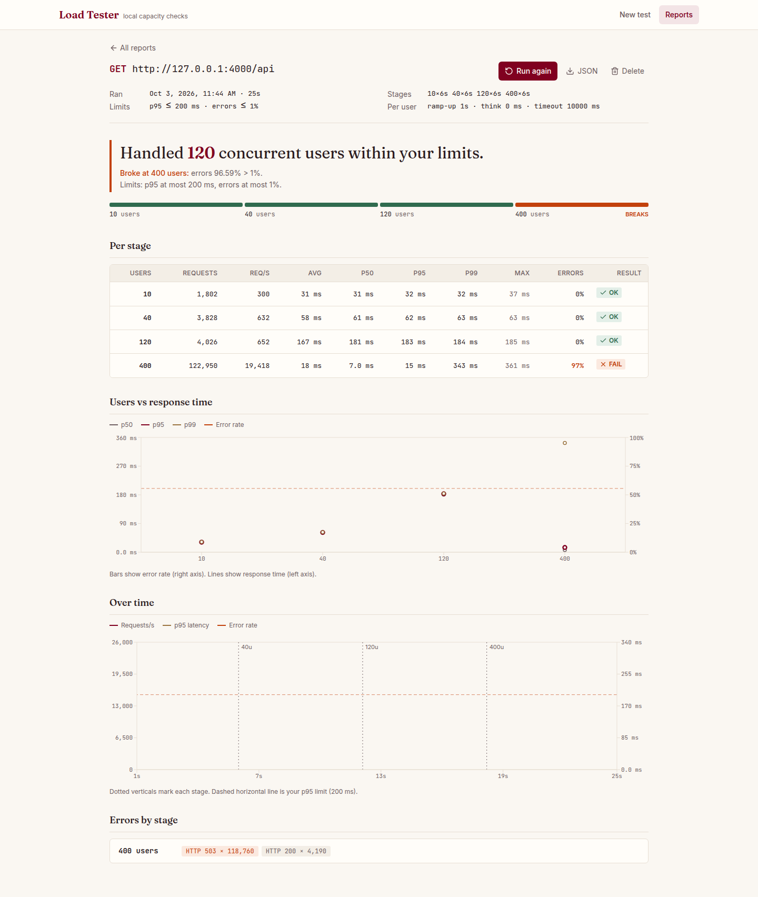
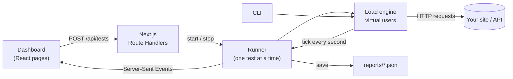

<div align="center">

# Load Tester

### How many users can your site handle before it slows down or breaks?

Step up concurrent users stage by stage, watch response times live, and get a one-line answer.<br/>
Runs entirely on your machine. No cloud account, no agents, no config files.

<br/>


[](LICENSE)

<br/>

[Quick start](#-quick-start) · [Features](#-features) · [Screenshots](#-screenshots) · [How it works](#-how-it-works) · [CLI](#-cli) · [API](#-api) · [Roadmap](#-roadmap)

<br/>



</div>

---

## ✨ Features

<table>
<tr>
<td width="50%" valign="top">

### 🎯 Stepped load stages
Run 10, then 50, then 100, then 500 users, one stage after another. Each stage gets its own results, so you see exactly where performance drops.

### 📈 Live dashboard
Active users, requests per second, p95 latency and error rate update every second, with a live chart marking each stage.

### ⚖️ Clear verdict
Set your limits (for example p95 under 500 ms, errors under 1%). The report tells you: *"Handled **120** users. Broke at **400**: errors 97% > 1%."*

</td>
<td width="50%" valign="top">

### 🗂️ Saved reports
Every run is saved as JSON. Browse history, open any report, **run it again** with one click, or download it.

### ⌨️ CLI for scripts and CI
Same engine from the terminal. Exits with code `2` when a stage breaks your limits, so it can fail a pipeline.

### 🧪 Built-in practice target
A demo server with limited capacity that queues requests and returns `503` when overloaded. Learn the tool safely before pointing it at your own app.

</td>
</tr>
</table>

**Also included:** ramp-up, think time, timeouts, custom headers and JSON bodies, all HTTP methods, keep-alive connections, instant stop, p50/p90/p95/p99 from a constant-memory histogram, status code and error breakdown, light and dark theme, mobile layout.

---

## 🚀 Quick start

```bash
git clone https://github.com/Soumya7681/load-tester.git
cd load-tester
npm install
npm run dev
```

Open **http://127.0.0.1:8089** and you are ready.

### Try it on the demo target first

```bash
npm run target      # in a second terminal, starts http://127.0.0.1:4000
```

In the dashboard click **Fill in http://127.0.0.1:4000/api**, then **Start test**. The demo handles 20 requests at a time, so you will see latency climb and then `503` errors appear as users increase.

> [!WARNING]
> Only load test sites and APIs **you own or have written permission to test**. Heavy traffic against someone else's server can look like a denial of service attack and may be illegal.

---

## 📸 Screenshots

<table>
<tr>
<td colspan="2"><b>Live test in progress</b><br/></td>
</tr>
<tr>
<td colspan="2"><b>Dark mode report</b><br/></td>
</tr>
<tr>
<td width="50%" align="center"><b>Mobile report</b><br/></td>
<td width="50%" align="center"><b>Mobile history</b><br/></td>
</tr>
</table>

<details>
<summary><b>Full report page</b></summary>
<br/>

</details>

---

## 🧠 How it works



| Term | Meaning |
|------|---------|
| **Virtual user** | A loop that sends a request, waits for the response, pauses for the think time, and repeats |
| **Stage** | A number of virtual users running for a number of seconds, e.g. *50 users for 30 s* |
| **Ramp-up** | Spreads user start-up over N seconds inside each stage, so the server is not hit all at once |
| **Pass / fail** | A stage passes when its p95 latency **and** error rate stay under your limits |

### Reading the results

| Metric | What it tells you |
|--------|-------------------|
| **Req/s** | Throughput: requests completed per second |
| **p50** | Typical response time. Half the requests were faster |
| **p95** | 95% of requests were faster than this. The best single number for "does it feel slow?" |
| **p99** | The slowest 1%. Shows outliers and queueing |
| **Errors** | Network errors, timeouts and HTTP status 400 or higher |

> [!TIP]
> Latency includes failed requests. A server that rejects requests quickly (for example `503` in 2 ms) can show a **lower** p95 while its error rate jumps. Always read latency and errors together. The verdict does this for you.

---

## ⌨️ CLI

```bash
npm run cli -- -u http://127.0.0.1:4000/api -n 10,50,100,200 -d 30 -r 5
```

```text
== Stage 3: 120 users for 6s ==
  t=    13s  users=  120  rps=   652  avg=   167.2ms  p95=   183.1ms  err=0%

Handled up to 120 concurrent users within SLA.
Broke at 400 users: errors 96.59% > 1%
```

<details>
<summary><b>All options</b></summary>

| Option | Default | Meaning |
|--------|---------|---------|
| `-u, --url` | | Target URL |
| `-n, --users` | `10,50,100` | Users per stage, comma separated |
| `-d, --duration` | `30` | Seconds per stage |
| `-r, --ramp-up` | `0` | Seconds to start all users in each stage |
| `-m, --method` | `GET` | HTTP method |
| `-H, --header` | | `"Name: value"`, repeatable |
| `-b, --body` | | Request body (JSON by default) |
| `--think-time` | `0` | ms each user waits between requests |
| `--timeout` | `10000` | ms per request |
| `--sla-p95` | `1000` | p95 limit in ms |
| `--sla-errors` | `1` | Error rate limit in % |
| `-c, --config` | | JSON config file (same shape as the API body) |
| `--json` | | Print the full report as JSON |

</details>

<details>
<summary><b>Config file example</b></summary>

```json
{
  "url": "http://localhost:3000/api/login",
  "method": "POST",
  "headers": { "Authorization": "Bearer <token>" },
  "body": "{\"email\":\"test@example.com\",\"password\":\"secret\"}",
  "stages": [
    { "users": 10, "duration": 30 },
    { "users": 50, "duration": 30 },
    { "users": 200, "duration": 60 }
  ],
  "rampUp": 5,
  "thinkTime": 500,
  "timeout": 10000,
  "slaP95": 800,
  "slaErrorRate": 1
}
```

```bash
npm run cli -- --config login-test.json
```

</details>

---

## 🔌 API

<details>
<summary><b>Endpoints</b></summary>

| Method and path | Purpose |
|-----------------|---------|
| `POST /api/tests` | Start a test (body: config above). `409` if one is running |
| `POST /api/tests/stop` | Stop the running test |
| `GET /api/events` | Server-Sent Events: `snapshot`, `started`, `stageStart`, `tick`, `stageEnd`, `done`, `failed` |
| `GET /api/reports` | List saved reports |
| `GET /api/reports/:id` | One report (`?download` to save as a file) |
| `DELETE /api/reports/:id` | Delete a report |

</details>

---

## 📜 Scripts

| Command | What it does |
|---------|--------------|
| `npm run dev` | Dashboard in development mode on `127.0.0.1:8089` |
| `npm run build` then `npm start` | Production build of the dashboard |
| `npm run target` | Demo practice server on `127.0.0.1:4000` |
| `npm run cli -- <options>` | Run a test from the terminal |
| `npm run typecheck` | Generate route types and run `tsc` |
| `npm run lint` | ESLint |

Demo capacity is adjustable: `CAPACITY=50 MAX_QUEUE=500 npm run target`.

---

## 🗂️ Project structure

```text
load-tester/
├── app/                  Pages and API routes (Next.js App Router)
│   ├── page.tsx          New test + live view
│   ├── reports/          History and single report pages
│   └── api/              tests, events (SSE), reports
├── components/           Dashboard UI: form, stage track, charts, tables
├── hooks/                Live event stream, theme colors for charts
├── lib/
│   ├── engine.ts         Virtual users, stages, metrics
│   ├── stats.ts          Latency histogram and percentiles
│   ├── runner.ts         Single running test + event fan-out
│   ├── schema.ts         Config validation (zod), shared by UI, API and CLI
│   └── reports.ts        Save, list, read, delete reports
├── cli/cli.ts            Command line runner
├── demo/target.ts        Practice server with limited capacity
├── docs/screenshots/     Images used in this README
└── reports/              Saved results (git ignored)
```

## 🧰 Tech stack

| Layer | Choice |
|-------|--------|
| Framework | Next.js 16 (App Router), React 19 |
| Language | TypeScript |
| Styling | Tailwind CSS 4 with burgundy and off-white design tokens |
| Charts | Recharts |
| Validation | zod |
| Icons | lucide-react |
| Engine | Node.js `http` / `https` with keep-alive agents |
| Live updates | Server-Sent Events |
| Storage | JSON files |

---

## ⚠️ Limits

- One test at a time.
- Up to **10,000 users** per stage, 20 stages, 1 hour per stage.
- The dashboard and the load share one Node.js process. For thousands of users the CLI gives more accurate numbers, and at very high load your own machine may become the bottleneck.
- The dashboard only listens on `127.0.0.1`, so other machines on your network cannot use it to send traffic.
- Built for local use (`next dev` / `next start`). It does not run on serverless hosting such as Vercel, because a test runs for minutes in one process.

---

## 🛣️ Roadmap

- [x] Stepped stages, live dashboard, verdict, saved reports, CLI, demo target
- [ ] Response checks (status, body contains, JSON field)
- [ ] Import a request from a cURL command
- [ ] Compare two runs side by side
- [ ] Export reports to CSV and HTML
- [ ] Breakpoint mode: keep adding users until the limits break
- [ ] Multi-step user journeys with variables and CSV test data
- [ ] Distributed workers for very high load

Full plan and more ideas in [`FEATURES.md`](FEATURES.md).

---

## 📄 License

[MIT](LICENSE) © 2026 Soumyaranjan

---

## 🤝 Contributing

Issues and pull requests are welcome. Before opening a PR, run:

```bash
npm run typecheck && npm run lint && npm run build
```

<div align="center">

<br/>

Made by **[Soumyaranjan](https://github.com/Soumya7681)**

</div>
